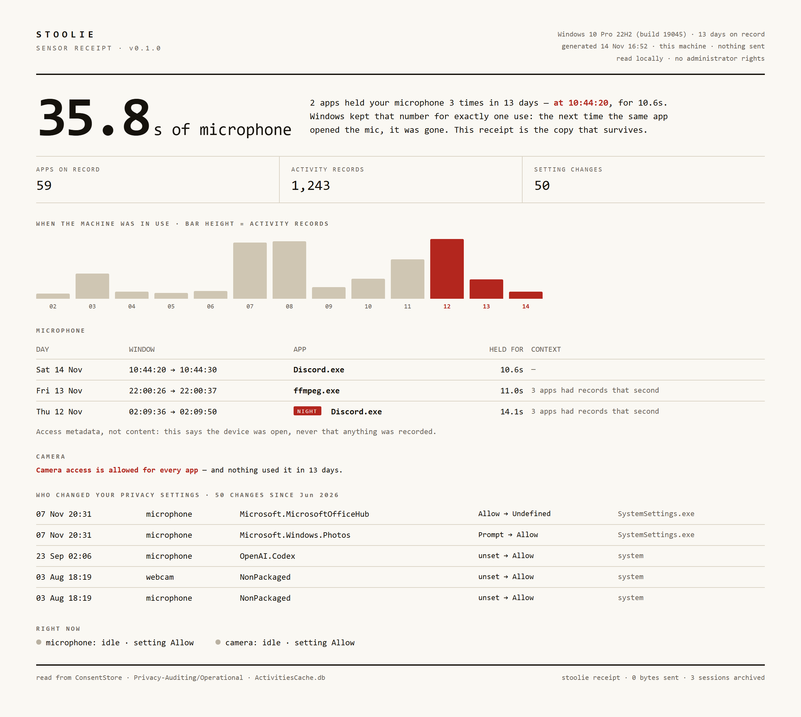

<div align="center">

# stoolie

**Windows keeps the last receipt. We keep all of them.**

A single Windows binary that shows which application held your microphone, camera or location —
for how long, when, and what else had activity records at that second — then writes it up as one
HTML receipt you can keep, print, or post.

[](https://github.com/0DukePan/stoolie/actions/workflows/ci.yml)
[](LICENSE)
[](#platform)

</div>

---

## Why

Windows records, for every application, the start and stop time of the **most recent** microphone,
camera and location use — and overwrites it the next time that app asks. Settings shows a short list;
nothing keeps the history, and there is no way to answer a question about last month.

`stoolie` reads the record Windows still has, keeps every future session in its own append-only
archive, and prints what it found. It does not capture audio or video, does not install a driver,
and does not touch the network.

## The receipt



One self-contained HTML file: headline numbers, a per-day activity strip, the sensor sessions with
their durations and context, the camera verdict, and the privacy-setting ledger. No scripts, no
fetched fonts, no network. It opens from a USB stick.

## What it shows you

```
  MICROPHONE
    Discord.exe            Thu 12 Nov  02:09:36 → 02:09:50   (14.1s)
      context: 4 apps had records that second
  CAMERA        access is allowed for every app · unused for 13 days
  PRIVACY LEDGER  50 changes since Jun 2026
    07 Nov 20:31  microphone  Prompt → Allow  Microsoft.Windows.Photos · SystemSettings.exe
  RIGHT NOW     microphone: idle   camera: idle
```

Three things are worth knowing about that output:

- **A duration, not a status.** `02:09:36 → 02:09:50 (14.1s)` is a fact. A tray icon is a light.
- **Context, not attribution.** The timeline records overlap, so the tool says how many apps had
  records at that second. It never claims to know which one you were looking at.
- **Access, not content.** The microphone being open is not a recording. The tool never claims one.

## Install

**From source** (Rust 1.83+, no administrator rights needed to run it):

```powershell
git clone https://github.com/0DukePan/stoolie
cd stoolie
cargo build --release
.\target\release\stoolie.exe
```

**From a release**, once a tag exists:

```powershell
irm https://raw.githubusercontent.com/0DukePan/stoolie/main/install.ps1 | iex
```

The installer downloads the release asset, checks it against the published SHA-256, and puts
`stoolie.exe` under `%LOCALAPPDATA%\stoolie\bin`.

## Use

```
stoolie                     summary for the last 13 days
stoolie receipt             write receipt.html and print where it went
stoolie receipt --open      write it and open it
stoolie watch               live: print when an app opens or closes a capability
stoolie json                machine-readable snapshot
stoolie doctor              which data sources work on this machine
stoolie --network           measure this process's outbound connections (it is zero)
```

`--since <days>` changes the window, `--no-color` disables ANSI.

## What it does NOT do

- **No capture.** Metadata only. Never audio, never video, never "we think it recorded".
- **No admin, no driver, no service.** It reads what Windows already writes, with your rights.
- **No network.** Not a check, not an update ping, not a crash report.
- **No cloud, no account, no sync.**
- **No accusations.** Durations and settings. You decide what is normal.

## Verify us with us

```
stoolie --network
```

It runs `netstat`, counts the sockets owned by its own process, and prints the number. There is no
network code in the binary — the flag exists so you do not have to believe this README.

## Platform

| Platform | Status |
|---|---|
| Windows 11 | the OS keeps ~30 days of capability history in a SQLite database (admin-only to read); stoolie uses the registry and its own archive |
| Windows 10 | the OS keeps one timestamp pair per app — **the archive starts on install** |
| macOS | not in v0.1: reading TCC needs Full Disk Access, and a permission prompt on first run is the friction this tool exists to avoid |
| Linux | not planned: there is no equivalent OS record, and we will not fake one |

`stoolie doctor` is the honest answer for any given machine: it lists which sources are readable
here, and says so when one is not.

## How accurate is it?

Read [docs/METHODOLOGY.md](docs/METHODOLOGY.md). The short version:

- **Recorded** — our own archive saw the session open and close.
- **Reported** — the OS wrote a start and a stop; we print both, unmodified.
- **Ledger** — a setting changed, and which process changed it. Not who used the capability.
- **Context** — the timeline overlapped at that second. Corroboration, never attribution.
- **Unknown** — a missing source is printed as unknown, with the reason. Never guessed.

## Privacy of the archive

The archive lives at `%LOCALAPPDATA%\stoolie\stoolie.db`, in plain SQLite, readable by you and by
anything running as you. It is not encrypted: an encrypted archive that only its author can read is
not a receipt, and a tool that hides its own records is not worth installing. `stoolie json` is the
supported way to export it.

## License

AGPL-3.0 — so nobody can sell your own sensors back to you.
